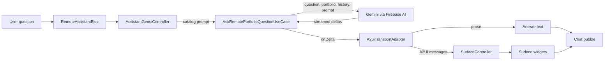
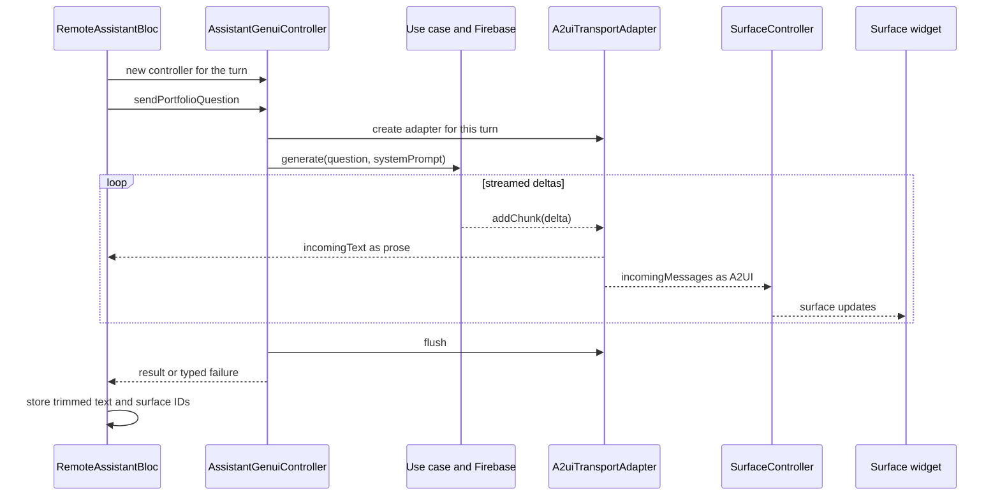

# Portfolio Assistant

The `assistant` feature provides provider-neutral message and response entities,
portfolio context generation, and the callback-driven conversation widget.
It does not import either provider, resolve their blocs, or select an inference engine.

## Features

- Portfolio-only context assembled by `GetAssistantContextUseCase`, including computed
  career overview, record digests, profile, experiences, projects, expertise, services
  and testimonials.
- Typed text responses and shared suggestions, message bubbles and chat input.
- Provisional streamed responses supplied by the caller, without provider-specific state.
- A read-only GenUI catalog of design-system components for structured answers.

## Getting Started

Register `AssistantModuleConfigurator` before the provider configurators. Import
`assistant.dart` from consumers, not private feature barrels.

The app registers independent `local_assistant` and `remote_assistant` modules.
Both consume this API; neither provider imports the other.

## Usage

The portfolio's `AssistantLauncherWidget` composes discovery:

| Local rollout | Cloud rollout | Offered |
|---------------|---------------|----------------------------------|
| Off | Off | No launcher |
| On | Off | On-device setup/chat directly |
| Off | On | Cloud chat directly |
| On | On | Cloud chat directly, never local fallback |

Offering a provider does not require local user enablement or model readiness.
The rollout enabler maintains mutually exclusive flags. If both are on, cloud takes
priority based on its flag alone, even if unsupported or in error.
The app never rewrites flags or preferences to enforce exclusivity. On-device is hidden
on web; cloud discovery depends only on its flag. Firebase generation supports configured
Android, iOS and web apps; unsupported platforms show an unavailable message inside cloud chat
rather than hiding its entry or exposing the other chat.

Settings exposes only local model management during local-only rollout. Remote chat entry
appears only on the portfolio, based on the cloud flag rather than platform support, context
retrieval or session readiness. Both chat toolbars offer a clear-chat control; only the
on-device chat offers an informational dialog about local processing and in-memory history.
Conversations remain in independent singleton blocs across navigation. There is no
chooser, context switch, automatic fallback or transfer of history between features.

Provider blocs, events and states are module-internal. Routes and public cards own
`BlocProvider.value` for their module's retained singleton; there are no app-wide assistant
bloc providers. Portfolio and Settings blocs read rollout flags directly through
`IsFeatureEnabledUseCase` and use the public feature-owned
`IsLocalAssistantSupportedUseCase` boolean platform check for local discovery, refreshing on
visibility/return. The local route is registered only on supported platforms, and local
domain operations recheck platform support before native model access. The repository checks
the local rollout flag and propagates native SDK errors. Visiting Settings or the portfolio
does not initialize remote chat or load its context. The local provider-owned visibility widget
still rechecks its retained session.
Remote chat rechecks rollout and platform support on chat visibility/return and before requests,
invalidating retained output when unavailable, without exposing its bloc to hosts.
Priority is a simple remote-first check in the portfolio and Settings composition.
A failed remote flag check hides both providers, rather than falling back to local.
The shared assistant module remains provider-neutral, and providers do not import siblings.

## Configuration

### Generative UI

The remote chat can render structured answers (metrics, tags, info rows, cards)
instead of plain text. It uses the published experimental `genui` **0.10.4**
package, which implements A2UI **v0.9**, with `json_schema_builder` **^0.1.6**
(0.1.3 lacks the `SchemaRegistry` the runtime needs). The feature is behind the
default-off flag `feature_remote_assistant_generative_ui`. With the flag off, remote
answers are plain text and none of the code below runs. The local assistant never
uses it.

The model does not return widgets. It returns text and A2UI JSON messages that
describe a UI. The app builds widgets only from components its catalog allows.

#### Concepts

| Concept | Package type | Role |
| --- | --- | --- |
| Catalog | `Catalog`, `CatalogItem` | The components the model may use. Each item has a name, a JSON schema and a widget builder. The schemas become the model prompt, and anything outside the catalog is rejected. |
| Transport adapter | `A2uiTransportAdapter` | Splits streamed model output into prose (`incomingText`) and parsed A2UI messages (`incomingMessages`). It copes with chunks that split a JSON message. Single use: it cannot take input after `flush()`. |
| Surface controller | `SurfaceController` | Holds the state of every surface: components and data. Applies `createSurface`, `updateComponents`, `updateDataModel` and `deleteSurface`. |
| Surface | `Surface` widget | Renders one surface from `controller.contextFor(surfaceId)` and rebuilds when the controller changes. |
| Data model | `DataModel`, `BoundString` | A JSON store per surface. A string property such as `{"path": "/message"}` binds to it and updates when `updateDataModel` changes the value. |
| Prompt builder | `PromptBuilder.chat` | Turns the catalog into the system prompt that explains the A2UI format. |

The package also provides a `Conversation` facade that bundles controller,
transport and chat history. The app does not use it: chat history, Firebase calls,
flags, limits and errors stay in the app's own bloc and use case.

#### Catalog

`createAssistantCatalog()` exposes read-only design-system components under catalog
ID `dev.portrai.assistant`. Components live in `presentation/catalog/item/`.

| Component | Renders |
| --- | --- |
| `DSText` | Text with `variant` `heading`, `title`, `body` or `caption` |
| `DSMetric` | A highlighted value with a label |
| `DSBulletList` | A bulleted list of literal strings |
| `DSLabeledInfoRow` | An icon with a label and value |
| `DSTag`, `DSInfoChip` | Skill badges and icon and label pills |
| `DSColumn`, `DSWrap` | Vertical and wrapping layouts of child component IDs |
| `DSCard`, `DSExpandable` | A grouped card and a title that expands to one child |
| `DSImage` | A portfolio image (`avatar`, `logo`, `banner`). Registered only when the portfolio context has HTTPS URLs, and renders only URLs present in that context |
| `DSMap` | An interactive Google map with one marker. Registered only when the portfolio context has coordinates, and renders only coordinates present in that context. Android, iOS and web only |
| `DSDivider` | A horizontal divider |

String properties accept a literal or a data-model reference. Child properties are
component IDs built by `CatalogItemContext.buildChild`. Icons come from a fixed
name list, and unknown names fall back to an info icon. No basic catalog, client
functions, actions, navigation, media or network widgets are registered.

#### Flow





Each A2UI message must sit in its own ```` ```json ```` block. The response-style
instruction appended by `sendPortfolioQuestion` tells the model to answer inside
one surface, avoid markdown, choose the component that fits the data and never
repeat surface content as text.

#### Classes

`AssistantGenuiController` (`presentation/controller/`) is a per-turn lifecycle
object, like Flutter's `ScrollController`: a widget or bloc creates and disposes it.
It owns a `SurfaceController`, exposed as `surfaceController`, builds `systemPrompt`
with `PromptBuilder.chat`, and offers `send<T>(message, generate:, onText:,
onSurfaceUpdate:)`. `generate(message, systemPrompt, onDelta)` is supplied by the
caller, forwards deltas and returns its domain result, including `Either`.

- Each turn gets a fresh adapter, and concurrent sends are rejected.
- A scoped error zone turns internal parser errors and generation exceptions into
  `AssistantGenuiResponseException`, without logging generated payloads.
- Framework validation errors (for example an unknown component) arrive on
  `surfaceController.onSubmit` and are reported through `frameworkErrors`.
- `acquireSurface()` counts mounted `Surface` widgets so the controller is not
  disposed while one is on screen. Unmount surfaces before `reset()` or `dispose()`.
- `reset()` replaces the surface controller. Both invalidate pending sends and
  ignore late deltas. Backend generation itself is not cancelled.

`RemoteAssistantGenuiControllerExtension.sendPortfolioQuestion`
(`remote_assistant/presentation/controller/`) connects the controller to
`AskRemotePortfolioQuestionUseCase` with a known text question, authoritative
portfolio context and typed history, not arbitrary framework messages.

#### Remote chat integration

- `RemoteAssistantBloc` creates a controller per question when the flag is on,
  records `RemoteAssistantSurface(messageIndex, genuiController, surfaceId)` in
  state, and disposes controllers on clear chat, failure, flag change and close.
- Completed history sent to the model contains only text, never surfaces.
- The chat shows each answer's trimmed text followed by its `Surface` widgets.
- On a failure the partial text and surfaces are discarded and a typed remote
  failure is shown.

#### Firebase request

The use case's optional `systemPrompt` accepts trusted framework instructions up to
50,000 characters. Oversized prompts are rejected, never truncated. Firebase keeps
its portfolio grounding instructions and appends the framework prompt as
subordinate presentation instructions. A null prompt keeps the text-only model
configuration, and a changed prompt closes and recreates the cached model. The
model uses `ThinkingLevel.low` and a 4096 token output limit, because thinking
tokens share that budget and can end a response with `maxTokens`. Request
parameters stay metadata-only in diagnostics.

### On-device

- Default-off rollout key: `feature_ai_assistant`.
- Compatibility route: `/assistant`; preference cache key: `assistant_enabled_cache`.
- Gemma 4 E2B via `flutter_edge_ai` and LiteRT-LM; the pinned model ID, file and
  revision live in `FlutterEdgeAiLocalAssistantRepository`.
- Explicit model download confirmation, progress, cancellation, keep/delete and retry
  controls remain available from Settings and the setup screen.
- Installed models load lazily on a question. A readiness inference probes engine support.
- Questions use deterministic contact/career answers where applicable and otherwise
  bounded context selection. Missing portfolio facts are not guessed.
- Disable and reset invalidate late output and clear follow-up context. Reset retains
  enablement and downloaded files. Invalidating output does not guarantee cancellation
  of native generation; download cancellation waits for cleanup.
- If native generation is still finishing after reset, a new request reports a localized
  busy failure instead of starting a concurrent native request.

### Cloud

- Independent default-off rollout key: `feature_remote_assistant`.
- Route: `/remote-assistant`; its entry is flag-only. Runtime rollout and platform guards show
  unavailability inside chat.
- Questions, bounded recent completed history and portfolio context are sent to Google
  through Firebase. The remote chat has no provider badge or disclosure control.
- There is no saved remote consent, enablement preference or user activation toggle.
- Opening the screen loads portfolio context but never calls the model until a question.
- Clear chat resets only the remote in-memory session.
- Failed partial responses never enter future provider history.
- Flag-off rechecks/reset stop local consumption and close the owned transport, but cannot undo
  requests already sent or guarantee server cancellation or cessation of billing.
- Request/state logging and analytics exclude cloud prompts and generated content.

Both routes, enable actions and new requests check rollout and platform availability.
Flags are rechecked on screen visibility/return and before new requests, without notifications
or polling. The app-level local access policy also guards direct local routes and requests
for their own rollout. Explicit provider routes retain independent access; discovery and
Settings select remote first without a shared policy registry. Local disable and both providers' reset/flag-off rechecks
invalidate late output; they do not guarantee
native or server cancellation. Repository exceptions map to localized failures in use cases.

Production cloud use requires separately validated Firebase App Check enforcement, model
availability and spending controls, plus an authorized release smoke test. Automated tests
do not make live or billable requests or prove console enforcement.
See the [Firebase AI setup guide](../../../../../../layer/firebase/README.md#firebase-ai-logic-setup).

## Testing

From `app/portrai`:

```bash
flutter gen-l10n
dart run build_runner build
flutter analyze lib test
flutter test test/src/feature/assistant test/src/feature/local_assistant \
  test/src/feature/remote_assistant test/src/feature/setting test/src/feature/portfolio
```

Tests use deterministic fixtures and mocked inference. They cover discovery combinations,
unsupported platforms, flag-only cloud activation, direct-route guards, pending-request invalidation,
local download consent, and independent sessions. No model download or live AI generation is needed.
The catalog widget tests feed real v0.9 messages through `A2uiParserTransformer`
and `SurfaceController` into `Surface`, covering DS composition, literal text,
binding updates, surface deletion and unsupported-component error reporting.
Controller tests exercise the actual adapter/parser/controller/surface pipeline,
callback results, parser and generation errors, sequential turns and late-delta invalidation.
Remote repository tests connect mocked Firebase streams through the real portfolio
use case and controller to the official surface controller, with no live requests.

Portfolio information limitations are documented in [DATA_GAPS.md](DATA_GAPS.md).

### Maps API Key

`DSMap` uses `google_maps_flutter`, which needs one Google Maps API key per platform. Keys are not committed. Create each key in Google Cloud Console under APIs & Services, Credentials, Create credentials, API key, in a project with billing enabled.

| Platform | API restriction (enable the API first under Library) | Application restriction | Where the key goes |
|---|---|---|---|
| Android | Maps SDK for Android | Android apps: package `com.mayandro.portrai` plus one SHA-1 per signing key (debug, release, Play App Signing) | `portRaiMapKeyAndroid` in `~/.gradle/gradle.properties`, or the `MAPS_API_KEY` environment variable |
| iOS | Maps SDK for iOS | iOS apps: bundle ID of the Runner target | `MAPS_API_KEY = <key>` in the git-ignored `ios/Flutter/Secrets.xcconfig` |
| Web | Maps JavaScript API | Websites: HTTP referrers such as `https://<domain>/*` and `http://localhost:*/*` for local runs | `MAPS_API_KEY_WEB` in the git-ignored `app/portrai/.env.production`; the `deploy_portrai` script (and CI) replaces the `MAPS_API_KEY` placeholder in the built `index.html` |

Get an Android SHA-1 with `keytool -list -v -alias <alias> -keystore <keystore>` or `./gradlew signingReport` in `android`. The debug keystore is `~/.android/debug.keystore` with alias `androiddebugkey` and password `android`.

CI reads the keys from the `MAPS_API_KEY_ANDROID`, `MAPS_API_KEY_IOS` and `MAPS_API_KEY_WEB` repository secrets and passes them to the build workflows as `MAPS_API_KEY`.
