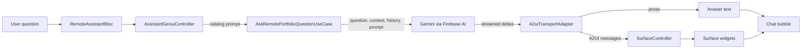

# Portfolio Assistant

The `assistant` feature is the shared base of the two portfolio assistants. It provides
provider-neutral message and response entities, portfolio context generation, the
callback-driven conversation widget and the read-only generative UI catalog. It imports neither
`local_assistant` (on-device inference) nor `remote_assistant` (Firebase AI), and neither of those
imports the other. The `job_opening` feature also uses `AssistantGenuiController` with
`AskRemotePortfolioQuestionUseCase` for its insights.

## Features

- `AssistantMessageEntity` (`content`, `isUser`) and the sealed `AssistantResponseEntity`, whose
  only subtype is `AssistantTextResponseEntity` (`text`).
- `GetAssistantContextUseCase` builds the portfolio context as one JSON string from
  `GetPortfolioUseCase`. A portfolio that fails to load returns
  `GetAssistantContextUnknownFailure`.
- `AssistantConversationWidget` renders a conversation without owning a provider or lifecycle:
  starter suggestions before the first message, message bubbles, a loading indicator while a
  question is sent, an optional header and error text, and the text input. The caller supplies
  the messages, `onSubmit`, optional `suggestions` and an optional `messageContentBuilder` that
  replaces a bubble's text.
- `createAssistantCatalog()` and `AssistantGenuiController`, which render structured answers
  with design-system components (see [Generative UI](#generative-ui)).
- `assistantUrlsFrom`, `assistantContactLinksFrom` and `assistantLocationsFrom`, which collect
  the links and coordinates in the portfolio context that a generated answer may use.

## Key Concepts

### Modules

`AssistantModuleConfigurator`, `LocalAssistantModuleConfigurator` and
`RemoteAssistantModuleConfigurator` are registered in that order. Consumers import the public
barrels `assistant.dart`, `local_assistant.dart` and `remote_assistant.dart`.

Each provider keeps its bloc, events and states internal. `LocalAssistantBloc` and
`RemoteAssistantBloc` are singletons, and their screens use `ScreenScaffoldWidget` with
`isRetained: true`, so each conversation survives navigation. The two conversations are
independent: there is no fallback, chooser or history transfer between them.

| Module             | Public API used by other features                                                                                                             |
| ------------------ | --------------------------------------------------------------------------------------------------------------------------------------------- |
| `local_assistant`  | `LocalAssistantFeatureFlags`, `IsLocalAssistantSupportedUseCase`, `LocalAssistantScreen`, `LocalAssistantCardWidget`, `LocalAssistantVisibilityWidget` |
| `remote_assistant` | `RemoteAssistantFeatureFlags`, `IsRemoteAssistantSupportedUseCase`, `AskRemotePortfolioQuestionUseCase`, `RemoteAssistantScreen`                  |

### Entry points

The portfolio and Settings blocs read the rollout flags through `IsFeatureEnabledUseCase` when
the screen loads and whenever it becomes visible again. The remote flag is checked first:

| `feature_remote_assistant` | `feature_ai_assistant` | Portfolio `AssistantLauncherWidget` | Settings AI section |
| -------------------------- | ---------------------- | ----------------------------------- | ------------------- |
| On                         | Any                    | Opens `/remote-assistant`           | Hidden              |
| Off                        | On, not web            | Opens `/assistant`                  | Shown               |
| Off                        | Off, or web            | Hidden                              | Hidden              |
| Fails to read              | Any                    | Hidden                              | Hidden              |

The launcher does not depend on the local model being enabled or downloaded; the local screen
shows the setup when it is not ready. The remote entry depends only on its flag. The remote chat
itself shows an unavailable message on platforms other than Android, iOS and web.

`LocalAssistantVisibilityWidget` wraps the portfolio and Settings screens and sends the retained
local bloc a recheck whenever they become visible. Visiting them never starts the remote chat or
loads its context.

### Portfolio context

`GetAssistantContextUseCase` returns a JSON object with these keys:

| Key            | Content                                                                                                                                                                                   |
| -------------- | ----------------------------------------------------------------------------------------------------------------------------------------------------------------------------------------- |
| `asOf`         | Today's date                                                                                                                                                                              |
| `overview`     | Computed career lines, then education and spoken languages                                                                                                                                |
| `digest`       | One line per profile, experience, project, skill group and service                                                                                                                        |
| `profile`      | Profile fields, including availability, working hours, location with coordinates, languages, educations, certifications, social links and resume                                           |
| `experiences`  | Every role with dates, an employment summary, coordinates and the titles of its projects                                                                                                  |
| `projects`     | Every project with a `links` sentence per market (missing links written as "not found"), markets with coordinates, metrics and the company and position of its experience              |
| `expertises`   | Skill groups with each skill's level, years and last use where given                                                                                                                      |
| `services`     | Services with deliverables, linked projects, process and FAQ                                                                                                                              |
| `testimonials` | Testimonials with their experience and the linked projects of that experience                                                                                                             |

The overview states figures the models would otherwise have to calculate: role and company
counts, total experience, shortest, longest, first and current role, time per company, country
and city, roles by work mode (the bracketed tag in a location such as `[Remote]`), career gaps and
job changes, leadership roles, every role in chronological order and by length, and time per
technology. Durations count whole months, and overlapping roles count each month once.

### Generative UI

With `feature_remote_assistant_generative_ui` on, remote answers can include design-system
surfaces. The model returns text and A2UI messages that describe a UI; the app builds widgets
only from the components its catalog registers. The local assistant does not use this. The app
uses `genui` 0.10.4 (A2UI v0.9) and `json_schema_builder` ^0.1.6.

| Package type                | Role                                                                                                         |
| --------------------------- | ------------------------------------------------------------------------------------------------------------ |
| `Catalog`, `CatalogItem`    | The components the model may use, each with a name, a JSON schema and a widget builder                       |
| `PromptBuilder.chat`        | Turns the catalog into the system prompt that explains the A2UI format                                       |
| `A2uiTransportAdapter`      | Splits streamed model output into prose (`incomingText`) and A2UI messages (`incomingMessages`)              |
| `SurfaceController`         | Holds the components and data model of every surface and applies incoming messages                           |
| `Surface`                   | Renders one surface from `surfaceController.contextFor(surfaceId)`                                           |
| `DataModel`, `BoundString`  | A JSON store per surface; a string property such as `{"path": "/message"}` binds to it                       |

The package's `Conversation` facade is not used; history, requests, flags, limits and errors stay
in `RemoteAssistantBloc` and `AskRemotePortfolioQuestionUseCase`.

#### Catalog

`createAssistantCatalog()` builds the catalog `dev.portrai.assistant`. Its items live in
`presentation/catalog/item/`.

Always registered:

| Component                   | Renders                                                                                       |
| --------------------------- | --------------------------------------------------------------------------------------------- |
| `DSText`                    | Text with `variant` `heading`, `title`, `body` or `caption`                                   |
| `DSMetric`                  | A highlighted value with a label                                                              |
| `DSStatGrid`                | Up to four `DSMetric` components side by side                                                 |
| `DSBulletList`              | A bulleted list of literal strings                                                            |
| `DSLabeledInfoRow`          | An icon with a label and value                                                                |
| `DSTag`, `DSInfoChip`       | A badge, and an icon and label pill                                                           |
| `DSTimeline`                | Up to 8 entries with `period`, `title` and `subtitle`                                         |
| `DSEducationList`           | Up to six entries with institution, degree and period                                         |
| `DSSkillBars`               | Up to 10 bars scaled to the largest value, each with an optional display label                |
| `DSProgressRing`            | A circular gauge for a value from 0 to 100, with an optional caption                          |
| `DSComparison`              | A table of up to four columns and eight rows                                                  |
| `DSQuote`                   | A quotation with optional author and role                                                     |
| `DSCallout`                 | A note styled `info`, `success` or `warning`                                                  |
| `DSCodeBlock`               | A snippet of at most 40 lines that scrolls sideways                                           |
| `DSProjectCard`             | Title, description, up to eight tags, an optional banner and an optional action component; the banner renders only for a URL in the portfolio context |
| `DSColumn`, `DSWrap`        | Vertical and wrapping layouts of child component IDs                                          |
| `DSCard`, `DSExpandable`    | A card around one child, and a title that expands to one child                                |
| `DSCarousel`                | A horizontally scrolling row of up to ten children                                            |
| `DSTabs`                    | Up to five titled tabs, each showing one child                                                |
| `DSDivider`                 | A horizontal divider                                                                          |

Registered only when the caller supplies what they need:

| Component                     | Registered when                                            | Renders                                                                                                   |
| ----------------------------- | ---------------------------------------------------------- | --------------------------------------------------------------------------------------------------------- |
| `DSImage`                     | `allowedUrls` is not empty                                 | An `avatar`, `logo` or `banner` image, only for an allowed URL                                            |
| `DSLinkButton`, `DSContactCard` | Allowed URLs or contact links exist and `onOpenLink` is set | A button, or up to five `email`, `phone` or `website` buttons, opening only allowed links               |
| `DSSuggestionChips`           | `onAskQuestion` is set                                     | Up to four tappable follow-up questions                                                                   |
| `DSMap`                       | `allowedLocations` is not empty                            | A Google map with up to 12 markers, only for allowed coordinates, framed to fit them; Android, iOS and web only |

`RemoteAssistantBloc` derives the allowed content once per portfolio context: every HTTPS URL in
it (`assistantUrlsFrom`), `mailto:` and `tel:` links for the profile email and phone
(`assistantContactLinksFrom`), and every latitude and longitude pair, which covers the profile
location, experiences and project markets (`assistantLocationsFrom`). Anything else renders
nothing. String properties accept a literal or a data-model reference, child properties are
component IDs, and icons come from a fixed name list with an info icon for unknown names. No
basic catalog or client functions are registered.

#### Controller

`AssistantGenuiController` (`presentation/controller/`) builds the catalog from the allowed
content and callbacks, owns a `SurfaceController` (`surfaceController`) and builds `systemPrompt`
with `PromptBuilder.chat`. `send<T>(message, generate:, onText:, onSurfaceUpdate:)` runs one turn;
the caller's `generate(message, systemPrompt, onDelta)` performs the request, forwards streamed
deltas and returns its own result.

- Each turn uses a fresh `A2uiTransportAdapter`, and a send while a turn is active fails.
- Parser, framework and generation errors complete the turn with
  `AssistantGenuiResponseException`, without logging generated content. Framework validation
  errors, such as an unknown component, are also emitted on `frameworkErrors`.
- `acquireSurface()` counts mounted `Surface` widgets. `reset()` throws while any is mounted;
  `dispose()` defers disposing the surface controller until the last one is released.
- `reset()` and `dispose()` invalidate the active turn and ignore later deltas. They do not
  cancel the backend request.

`RemoteAssistantGenuiControllerExtension.sendPortfolioQuestion` (in `remote_assistant`) sends a
text question through `AskRemotePortfolioQuestionUseCase`. It appends a response-style
instruction to the catalog prompt: answer inside one surface, use plain text, pick the component
that fits the data, and put each A2UI message in its own `json` code block. It adds image, link,
suggestion and map instructions only for the components that are registered. When the guest user
has a saved role, it adds a fixed instruction: developers get projects, technologies and
architecture first; recruiters get availability, experience, career history and contact first.
A turn that ends with no text and no surface returns `RemoteAssistantIncompleteFailure`.



#### Remote chat integration

- `RemoteAssistantBloc` creates a controller per question and records each surface as
  `RemoteAssistantSurface(messageIndex, genuiController, surfaceId)`. The chat shows an answer's
  text followed by its `Surface` widgets.
- Link taps dispatch `OpenRemoteAssistantLinkClickEvent`, handled with `OpenExternalUrlUseCase`;
  suggestion chips dispatch `SendRemoteAssistantQuestionClickEvent`.
- History sent to the model contains only non-empty text messages, never surfaces. The chat keeps
  the latest 12 messages and their surfaces.
- A failed question discards its partial text and surfaces. A framework error clears the
  conversation and shows an incomplete-answer error.
- Controllers are disposed on clear chat, failure, a flag or mode change, and when the bloc
  closes.
- `systemPrompt` may be up to 80,000 characters; a longer one is rejected, not truncated.
  `FirebaseRemoteAssistantRepository` appends it after its grounding instruction as
  presentation instructions that must not override it, and recreates the cached model when the
  prompt changes.

### Local assistant

- Rollout flag `feature_ai_assistant`; route `/assistant`, registered only where
  `IsLocalAssistantSupportedUseCase` is true (every platform except web). The enablement
  preference is stored under `assistant_enabled_cache`.
- The model is `litert-community/gemma-4-E2B-it-litert-lm` (`gemma-4-E2B-it.litertlm`) at a
  pinned revision, installed and run with `flutter_edge_ai` and its LiteRT-LM engine.
- Settings and the setup screen show `LocalAssistantCardWidget`. Enabling asks for consent before
  a download (not for a model that is already on the device) and for the notification permission
  through the [`permission`](../permission/README.md) feature; either answer continues. While
  notifications are allowed, the download shows its progress in a notification and, on Android,
  runs in the foreground so it continues in the background. Turning the assistant off during a
  download cancels it and deletes the partial file; turning a ready assistant off asks whether to
  keep or delete the model.
- `LocalAssistantModelDownload.process` allows one download per app process. An in-app restart
  disposes the repository but not the download, and the next repository joins it with the
  progress reached so far. If the assistant is enabled and the model is missing at launch, the
  download resumes.
- After a download the model is loaded and must answer a short readiness prompt before the chat
  becomes ready. An installed model is marked ready at launch and loaded on the first question
  the model has to answer.
- Each question uses a freshly built portfolio context. `LocalAssistantDirectAnswerer` answers
  greetings, contact details and social links, salary (with the hourly rate), personal topics,
  projects by store or technology, the service list, time per place, company or technology,
  total experience, the overview's role facts and spoken languages directly from the context,
  without the model. It skips questions that name a product or another record, and also answers
  short follow-ups such as "and at Stuart?".
- Other questions go to the model with facts chosen by `LocalAssistantContextSelector`, at most
  10,000 bytes: matching records and digest lines first, the short overview lines after them, and
  the long career lists and technology totals only for career questions. IDs, image URLs and
  coordinates are left out, null fields are dropped and empty lists are written as
  "none listed". The previous question is included only when the new one uses a pronoun or
  continuation and names no company, project, technology or person.
- Generated text streams into the chat, is stripped of markdown, and has links that are not in
  the selected facts replaced with "(no link listed in the portfolio)". An answer that loops on a
  character or phrase is generated once more with a higher temperature and at most 6,000 bytes of
  facts.
- Clear chat and turning the assistant off invalidate pending output and clear follow-up context;
  native generation is not cancelled. A question asked while an earlier generation is still
  running returns `AskLocalPortfolioQuestionBusyFailure`.
- The chat toolbar has a clear-chat button and an information dialog about on-device processing.

### Remote assistant

- Rollout flag `feature_remote_assistant`; route `/remote-assistant`, always registered.
  `RemoteAssistantBloc` rechecks the flag and platform support whenever the screen becomes
  visible and before each question. When either fails, the chat shows an unavailable message,
  clears the conversation and resets the session.
- Opening the chat loads the portfolio context; the model is called only for a question. There
  is no consent, enablement preference or provider badge, and the toolbar has only clear chat.
- `AskRemotePortfolioQuestionUseCase` checks platform support, validates the input limits and
  reserves one request from the per-install budget before calling the repository, which checks
  the flag again. The model, limits and budget are listed in the app README under
  [Remote Assistant](../../../../README.md#remote-assistant) and
  [AI Request Limit](../../../../README.md#ai-request-limit).
- The guest user's saved role selects the starter suggestions and the role instruction.
- Clear chat resets only the remote session. Resetting stops reading the stream but cannot
  cancel a request already sent.
- Logs and analytics exclude questions and generated text.

Production use needs App Check enforcement, model availability and quota controls; see the
[Firebase AI setup guide](../../../../../../layer/firebase/README.md#firebase-ai-logic-setup).
Known gaps in the portfolio data are listed in [DATA_GAPS.md](DATA_GAPS.md).

## Configuration

| Flag                                     | Default | Effect                                         |
| ---------------------------------------- | ------- | ---------------------------------------------- |
| `feature_ai_assistant`                   | Off     | On-device assistant in Settings and on the portfolio |
| `feature_remote_assistant`               | Off     | Remote chat entry on the portfolio             |
| `feature_remote_assistant_generative_ui` | Off     | Design-system surfaces in remote answers       |

### Maps API Key

`DSMap` uses `google_maps_flutter`, which needs one Google Maps API key per platform. Keys are not committed. Create each key in Google Cloud Console under APIs & Services, Credentials, Create credentials, API key, in a project with billing enabled.

| Platform | API restriction (enable the API first under Library) | Application restriction | Where the key goes |
|---|---|---|---|
| Android | Maps SDK for Android | Android apps: package `com.mayandro.portrai` plus one SHA-1 per signing key (debug, release, Play App Signing) | `portRaiMapKeyAndroid` in `~/.gradle/gradle.properties`, or the `MAPS_API_KEY` environment variable |
| iOS | Maps SDK for iOS | iOS apps: bundle ID of the Runner target | `MAPS_API_KEY = <key>` in the git-ignored `ios/Flutter/Secrets.xcconfig` |
| Web | Maps JavaScript API | Websites: HTTP referrers such as `https://<domain>/*` and `http://localhost:*/*` for local runs | `MAPS_API_KEY_WEB` in the git-ignored `app/portrai/.env.production`; the `deploy_portrai` script (and CI) replaces the `MAPS_API_KEY` placeholder in the built `index.html` |

Get an Android SHA-1 with `keytool -list -v -alias <alias> -keystore <keystore>` or `./gradlew signingReport` in `android`. The debug keystore is `~/.android/debug.keystore` with alias `androiddebugkey` and password `android`.

CI reads the keys from the `MAPS_API_KEY_ANDROID`, `MAPS_API_KEY_IOS` and `MAPS_API_KEY_WEB` repository secrets and passes them to the build workflows as `MAPS_API_KEY`.

## Testing

From `app/portrai`:

```bash
flutter test test/src/feature/assistant test/src/feature/local_assistant test/src/feature/remote_assistant
```

The portfolio and Settings tests cover the entry points:

```bash
flutter test test/src/feature/portfolio test/src/feature/setting
```

The tests use fixtures and mocked inference and make no model download or live AI request. The
catalog tests feed A2UI v0.9 messages through `A2uiParserTransformer` and `SurfaceController`
into `Surface`. The controller and remote repository tests run the real adapter, parser and
surface controller against mocked generation and mocked Firebase streams.
`local_assistant_portfolio_evaluation_test.dart` runs the direct answers and fact selection over
the portfolio in `assets/dashboard`. Those files are git-ignored and the test is skipped when
they are absent; CI creates them from the `*.template.json` files.
