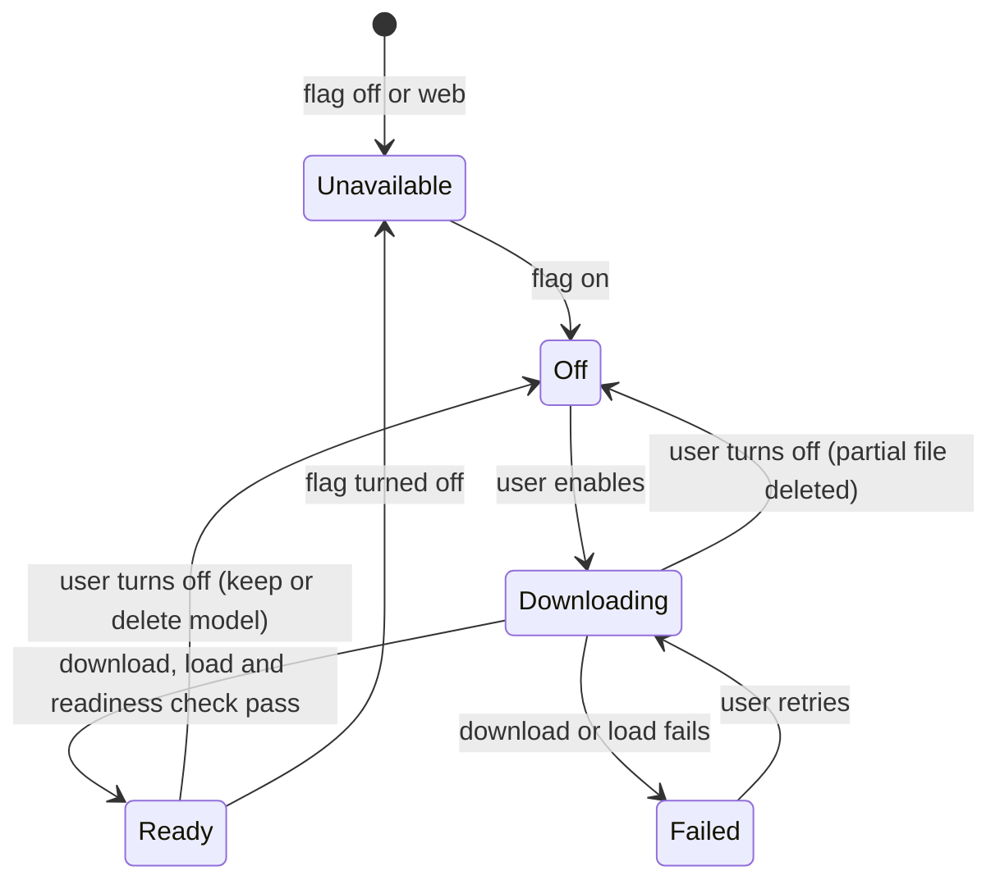
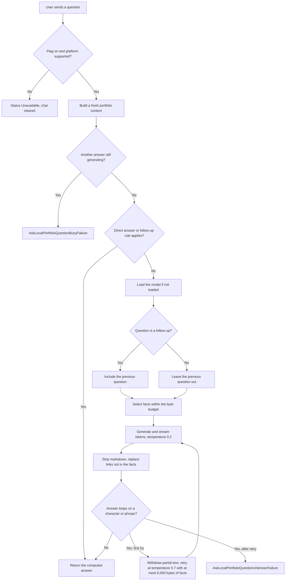

# Local Assistant

The `local_assistant` feature answers questions about the portfolio with a language model that
runs on the device. Questions, portfolio facts and answers never leave the device; the network is
used only to download the model file. It builds on the shared [`assistant`](../assistant/README.md)
feature for the portfolio context and the conversation widget.

## Features

- Opt-in setup from Settings or the assistant screen: consent, download with progress, load and a
  readiness check before the chat opens.
- Deterministic answers for facts the app already knows (contact details, tenure, salary, total
  experience and similar), without the model.
- Model answers grounded in facts selected for each question, streamed into the chat as they are
  generated.
- Turning the assistant off, with the choice to keep or delete the downloaded model.
- Available on every platform except web.

## How It Works

### Components

| Component                               | Role                                                                                          |
| --------------------------------------- | --------------------------------------------------------------------------------------------- |
| `LocalAssistantBloc`                    | Singleton shared by Settings, the portfolio launcher and the chat screen. Owns the status and the conversation. |
| `FlutterEdgeAiLocalAssistantRepository` | Downloads, loads, runs and unloads the model through `flutter_edge_ai` and its LiteRT-LM engine. |
| `LocalAssistantModelDownload`           | The single model download of the app process. A second caller joins the running download.     |
| `LocalAssistantDirectAnswerer`          | Rule-based answers computed from the portfolio JSON. Returns null when the model is needed.    |
| `LocalAssistantContextSelector`         | Scores portfolio facts against the question and keeps the best ones within a byte budget.     |
| `LocalAssistantEnabledCache`            | Stores the enablement preference under `assistant_enabled_cache`.                              |

The model is `litert-community/gemma-4-E2B-it-litert-lm` (file `gemma-4-E2B-it.litertlm`),
downloaded from Hugging Face at a pinned revision and run with the GPU as the preferred backend.

### Lifecycle

`LocalAssistantStatus` holds exactly one of these states:



- The module registers the `/assistant` route and sends `LocalAssistantInitializedEvent` only
  when `IsLocalAssistantSupportedUseCase` is true.
- `LocalAssistantVisibilityWidget` wraps the portfolio and Settings screens and sends the event
  again whenever they become visible, so a flag changed at runtime is picked up. Setup itself runs
  once per bloc.
- Enabling asks for the notification permission when a download is needed; either answer
  continues. With notifications allowed, the download shows its progress in a notification and,
  on Android, runs in the foreground so it continues in the background.
- After a download the model is loaded and must reply to `Reply with the word Ready.` with
  non-empty text (16 output tokens at most) before the status becomes ready.
- At launch, an enabled assistant whose model is installed is marked ready without loading the
  model. Opening the chat starts loading it in the background, and a question asked meanwhile
  waits for the same load. An enabled assistant whose model is missing resumes the download.

### Answering a question



1. Each question uses a freshly built portfolio context, because it states durations up to today
   and a retained chat can stay open for days. Unchanged text reuses the decoded copy.
2. `LocalAssistantDirectAnswerer` tries its rules in order; the first rule that applies and finds
   its fact wins. Short continuations such as "and at Stuart?" repeat the previous question for
   the newly named company, place or technology.
3. A question is a follow-up when it uses a pronoun or continuation word ("it", "that", "also",
   "what about") and names no company, project, technology or person of the portfolio. Only then
   is the previous question sent to the model.
4. `LocalAssistantContextSelector` flattens the portfolio into facts, drops IDs, image URLs and
   coordinates, splits long texts into parts of about 300 characters at sentence ends, scores
   every fact against the question's terms and adds facts in score order while they fit.
5. The facts and the question go together in the user turn. The system instruction, built with
   the owner's name from the portfolio, limits the model to the portfolio and asks for plain,
   concise sentences.

## Tokens

A token is the unit a language model reads and writes: a word, part of a word, a number or a
punctuation mark. The model has a fixed context window that must hold the system instruction,
the selected facts, the question and the generated answer together. Anything beyond it is cut off
or fails, so the prompt has to be sized before it is sent.

| Setting                        | Value                    | Where it applies                              |
| ------------------------------ | ------------------------ | --------------------------------------------- |
| `_maxTokens`                   | 8,192 tokens             | Whole context window of the loaded model      |
| Reserved for answer and template | 1,024 tokens           | Kept free when sizing the prompt              |
| `maxOutputTokens`              | 512 tokens               | Length of one generated answer                |
| Readiness check output         | 16 tokens                | The `Ready` probe after loading               |
| `maxContextBytes`              | 10,000 bytes             | Upper limit for the selected facts            |
| Retry facts limit              | 6,000 bytes              | Facts on the second attempt                   |
| `topK`                         | 40                       | Sampling: only the 40 likeliest next tokens are considered |
| Temperature                    | 0.2, retry 0.7           | Sampling randomness                           |

The app does not count tokens. It bounds them by UTF-8 bytes, assuming at least two bytes per
token, which overestimates the token count of English text (about three bytes or more per
token):

```text
availableBytes = (8192 - 1024) * 2 - bytes(systemInstruction + question + previousQuestion)
factBudget     = min(availableBytes, 10000)
```

- When `availableBytes` is below 512, the question is rejected as too long.
- The selector stops adding facts once the next one would exceed `factBudget`; facts are skipped,
  never truncated.
- Tokens stream from the engine as they are generated. Each partial text is cleaned and shown in
  the chat, and generation stops early when the text starts looping.
- An answer of 1,600 bytes or more that does not end with `.`, `!` or `?` is treated as cut off by
  the output limit and trimmed to its last full sentence.

## Caveats

- **Small model.** The model garbles numbers, dates and durations, which is why those questions
  are answered by rules. A question the rules do not cover can still get a wrong number.
- **Answers only from selected facts.** A fact that scores too low or does not fit the budget is
  not seen by the model, which then says the portfolio does not cover it.
- **English term matching.** Fact scoring, follow-up detection and the direct-answer rules match
  English words, so questions in other languages match fewer facts and rules.
- **Minimal memory.** The model sees at most the previous question, and only for a follow-up. It
  never sees earlier answers.
- **Links.** A URL in an answer that is not in the selected facts is replaced with
  "(no link listed in the portfolio)".
- **One question at a time.** A question asked while an earlier generation runs returns
  `AskLocalPortfolioQuestionBusyFailure`.
- **No native cancellation.** Clear chat and turning the assistant off discard pending output and
  the follow-up context, but the native generation runs until it finishes.
- **First question latency.** An installed model starts loading when the chat opens. A question
  the model has to answer before the load finishes waits for it.
- **Memory while the chat is open.** Opening the chat loads the model even when every question is
  answered directly. It stays loaded until the assistant is turned off or the app restarts.
- **Storage and memory.** The model file stays on the device until the user deletes it when
  turning the assistant off. A loaded model is unloaded when the assistant is turned off.
- **One download per process.** An in-app restart disposes the repository but not the download;
  the next repository joins it with the progress reached so far.
- **Web.** Not supported; the route is not registered and the entry points stay hidden.

## Public API

Exported from `local_assistant.dart`:

- `LocalAssistantFeatureFlags`
- `IsLocalAssistantSupportedUseCase`
- `LocalAssistantModuleConfigurator` and `LocalAssistantModuleRoute`
- `LocalAssistantScreen`
- `LocalAssistantCardWidget`
- `LocalAssistantVisibilityWidget`

The bloc, events, states and the other use cases stay internal.

## Configuration

| Flag                   | Default | Effect                                                  |
| ---------------------- | ------- | ------------------------------------------------------- |
| `feature_ai_assistant` | Off     | On-device assistant in Settings and on the portfolio    |

When `feature_remote_assistant` is on, the portfolio launcher opens the remote assistant instead;
see [Entry points](../assistant/README.md#entry-points).

## Dependencies

- `flutter_edge_ai`: model installation from Hugging Face, chat sessions and streaming.
- `flutter_edge_ai_litertlm`: the LiteRT-LM inference engine.
- [`permission`](../permission/README.md): the notification permission for download progress.

## Testing

From `app/portrai`:

```bash
flutter test test/src/feature/local_assistant
```

The tests use mocked inference (`MockInferenceModel`, `MockInferenceChat`) and make no model
download. `local_assistant_portfolio_evaluation_test.dart` runs the direct answers and fact
selection over the portfolio in `assets/dashboard`; it is skipped when those git-ignored files
are absent.
